<h1 align="center">
  <picture>
    <source media="(prefers-color-scheme: dark)" srcset="branding/banner-transparent-dark.png">
    
  </picture>
</h1>
<h3 align="center">会动、会讲解、还能自己导出的图。</h3>

<p align="center"><a href="README.md">English</a> &nbsp;·&nbsp; <strong>简体中文</strong></p>

<p align="center">让你的 AI 编程助手画一张图。SeeCode 把一段简短的规格变成一张出版级质感、带动画、可以探索的图：一个 HTML 文件，可以悬停、点击、一步步走查，也可以导出成 SVG、PNG、GIF 或 MP4，放到任何需要它的地方。</p>

<p align="center">
  <a href="#安装"><strong>安装</strong></a> &nbsp;·&nbsp;
  <a href="#45-种图表类型"><strong>图表类型</strong></a> &nbsp;·&nbsp;
  <a href="#实际效果"><strong>功能</strong></a> &nbsp;·&nbsp;
  <a href="#主题和你的品牌"><strong>主题</strong></a> &nbsp;·&nbsp;
  <a href="#导入已有的图"><strong>导入</strong></a> &nbsp;·&nbsp;
  <a href="#按用途导出"><strong>导出</strong></a> &nbsp;·&nbsp;
  <a href="#中文与国内网络"><strong>中文与国内网络</strong></a> &nbsp;·&nbsp;
  <a href="docs/cli.md"><strong>CLI</strong></a>
</p>

<p align="center">
  <a href="https://github.com/Aryanutkarsh/seecode/stargazers"></a>
  <a href="https://github.com/Aryanutkarsh/seecode/actions/workflows/ci.yml"></a>
  <a href="https://github.com/Aryanutkarsh/seecode/blob/main/package.json"></a>
  <a href="skills/seecode/SKILL.md"></a>
  
  <a href="LICENSE"></a>
</p>

<p align="center"></p>

<p align="center"><sub>直接从图里导出。▶ <a href="#实际效果">看看查看器怎么用</a>：悬停追踪、聚焦面板、路径演示。</sub></p>

## 装好之后，用大白话说你想看什么

**Claude Code**（推荐用插件，能一直跟上最新版本）：

```text
/plugin marketplace add Aryanutkarsh/seecode
/plugin install seecode@seecode
```

**Cursor、Codex、OpenCode 以及其他支持 Agent Skills 的工具：**

```bash
npx skills add Aryanutkarsh/seecode -g
```

[更多安装方式，以及怎么更新](#安装)。

然后这样问：

```text
用 SeeCode 画一下下单流程：浏览器调用 API，API 写入 Postgres，
调用 Stripe 扣款，再往 Kafka 发一条事件。
```

接着继续用大白话调整：「高亮支付这条路径」「换成深色」「导出来放到 PPT 里」。在某个项目里第一次使用时，SeeCode 会问你一次：用全局设置，还是给这个项目单独建一套设置。

## 45 种图表类型

每种图都有自己的动画方式（系统图会显示数据流向，时序图逐条播放消息，数据图会自己长出来），也都可以完全静态。点开任何一张都能看大图。数据图的数字来自 CSV 或 JSON 文件，数据不必经过模型。

<table>
<tr>
  <td align="center" width="33%"><a href="docs/screenshots/architecture.png">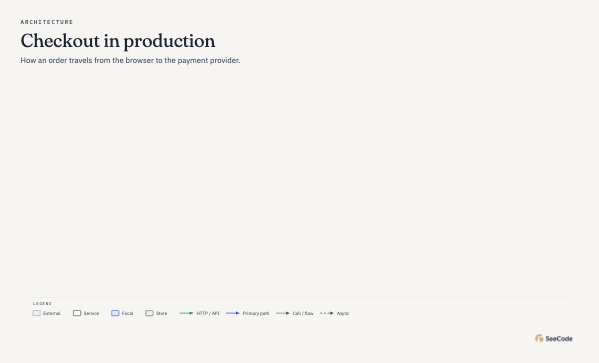</a><br><b>架构图</b><br><sub>组件和它们之间的连接</sub></td>
  <td align="center" width="33%"><a href="docs/screenshots/high-level.png">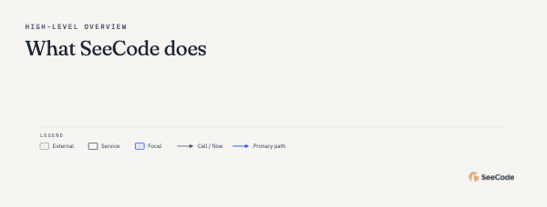</a><br><b>高层概览图</b><br><sub>给非技术同事看的 4–7 个框</sub></td>
  <td align="center" width="33%"><a href="docs/screenshots/deployment.png">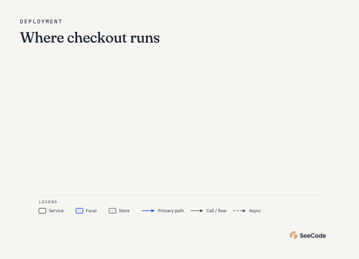</a><br><b>部署图</b><br><sub>东西跑在哪里（主机、区域）</sub></td>
</tr>
<tr>
  <td align="center" width="33%"><a href="docs/screenshots/dependency.png">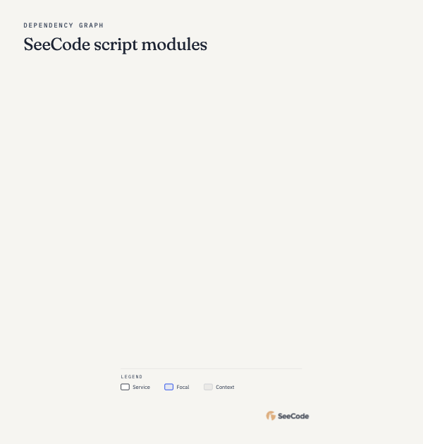</a><br><b>依赖图</b><br><sub>谁引用或依赖谁</sub></td>
  <td align="center" width="33%"><a href="docs/screenshots/architecture-delta.png">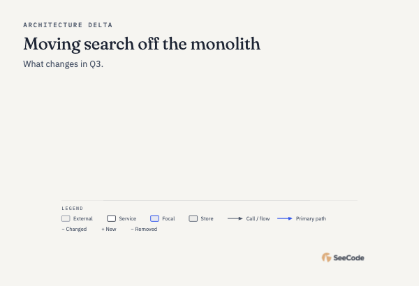</a><br><b>架构变更图</b><br><sub>一次改动新增、删除、修改了什么</sub></td>
  <td align="center" width="33%"><a href="docs/screenshots/it-state.png">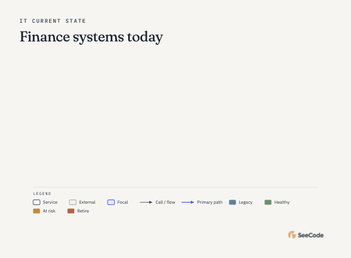</a><br><b>IT 现状图</b><br><sub>当前 IT 全景和健康状态</sub></td>
</tr>
<tr>
  <td align="center" width="33%"><a href="docs/screenshots/uml-class.png"></a><br><b>UML 类图</b><br><sub>类和接口</sub></td>
  <td align="center" width="33%"><a href="docs/screenshots/er.png">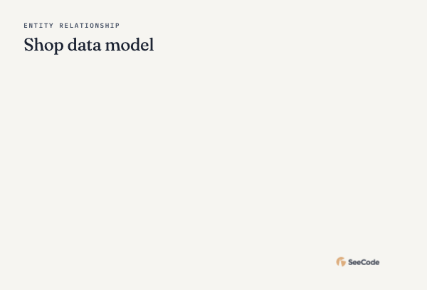</a><br><b>ER 图 / 数据模型</b><br><sub>实体和基数</sub></td>
  <td align="center" width="33%"><a href="docs/screenshots/db-schema.png">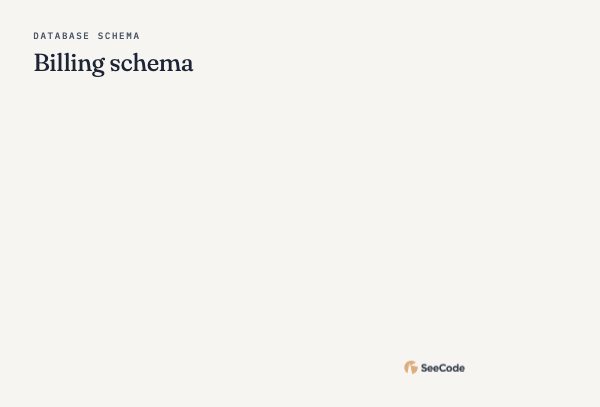</a><br><b>数据库表结构</b><br><sub>表和外键列</sub></td>
</tr>
<tr>
  <td align="center" width="33%"><a href="docs/screenshots/flowchart.png">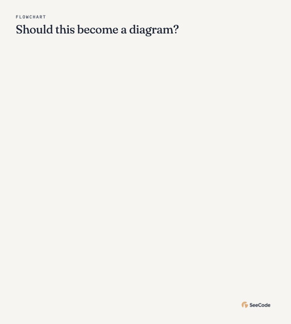</a><br><b>流程图</b><br><sub>判断和分支</sub></td>
  <td align="center" width="33%"><a href="docs/screenshots/sequence.png">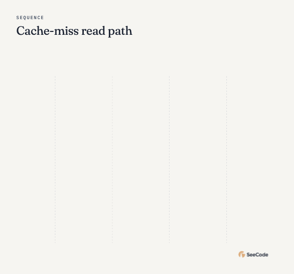</a><br><b>时序图</b><br><sub>参与者之间随时间往来的消息</sub></td>
  <td align="center" width="33%"><a href="docs/screenshots/state.png"></a><br><b>状态机</b><br><sub>状态和状态转换</sub></td>
</tr>
<tr>
  <td align="center" width="33%"><a href="docs/screenshots/swimlane.png"></a><br><b>泳道图</b><br><sub>哪一步由谁来做</sub></td>
  <td align="center" width="33%"><a href="docs/screenshots/process.png"></a><br><b>步骤图</b><br><sub>简短、线性、带编号的步骤</sub></td>
  <td align="center" width="33%"><a href="docs/screenshots/data-flow.png">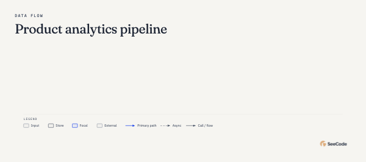</a><br><b>数据流图</b><br><sub>数据经过的各个阶段</sub></td>
</tr>
<tr>
  <td align="center" width="33%"><a href="docs/screenshots/journey.png">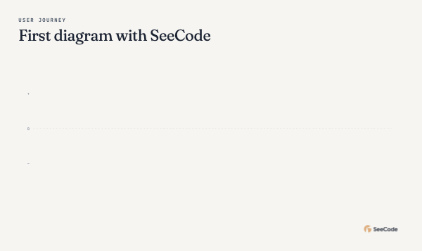</a><br><b>用户旅程图</b><br><sub>用户的每一步和情绪曲线</sub></td>
  <td align="center" width="33%"><a href="docs/screenshots/timeline.png"></a><br><b>时间线</b><br><sub>带日期的事件</sub></td>
  <td align="center" width="33%"><a href="docs/screenshots/gantt.png"></a><br><b>甘特图</b><br><sub>工作随时间的安排</sub></td>
</tr>
<tr>
  <td align="center" width="33%"><a href="docs/screenshots/kanban.png"></a><br><b>看板</b><br><sub>按状态分组的事项</sub></td>
  <td align="center" width="33%"><a href="docs/screenshots/story-map.png">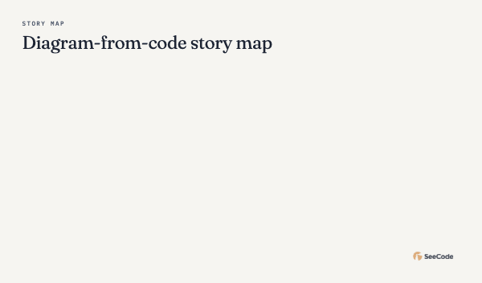</a><br><b>用户故事地图</b><br><sub>主干和发布切片</sub></td>
  <td align="center" width="33%"><a href="docs/screenshots/loop.png">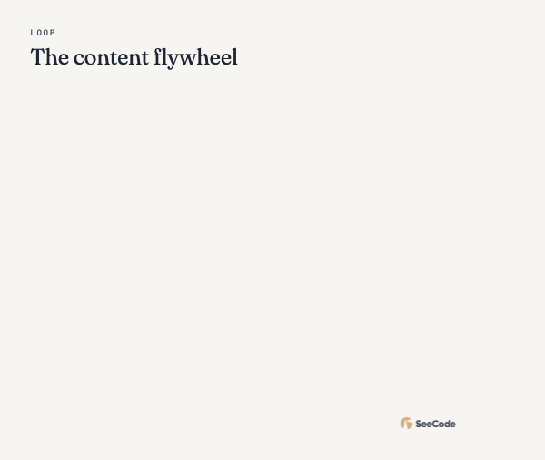</a><br><b>循环 / 飞轮</b><br><sub>相互增强的循环或飞轮</sub></td>
</tr>
<tr>
  <td align="center" width="33%"><a href="docs/screenshots/medallion.png">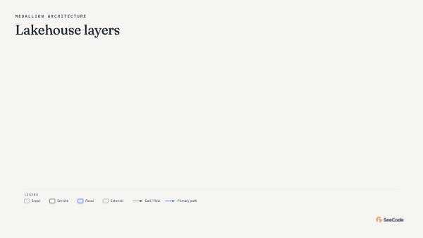</a><br><b>奖章架构（Medallion）</b><br><sub>铜 / 银 / 金三层数据</sub></td>
  <td align="center" width="33%"><a href="docs/screenshots/dp-integration.png">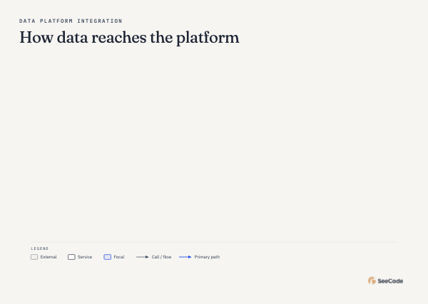</a><br><b>平台集成图</b><br><sub>数据源 → 集成 → 平台 → 服务</sub></td>
  <td align="center" width="33%"><a href="docs/screenshots/dp-security-matrix.png">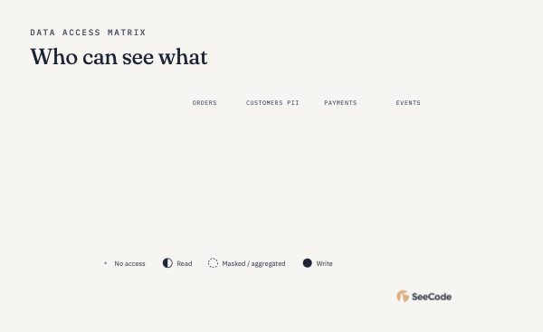</a><br><b>权限矩阵</b><br><sub>角色 × 数据访问</sub></td>
</tr>
<tr>
  <td align="center" width="33%"><a href="docs/screenshots/tree.png"></a><br><b>树图</b><br><sub>父节点 → 子节点</sub></td>
  <td align="center" width="33%"><a href="docs/screenshots/org-chart.png">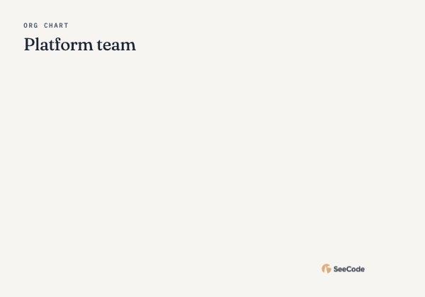</a><br><b>组织架构图</b><br><sub>人和团队</sub></td>
  <td align="center" width="33%"><a href="docs/screenshots/nested.png"></a><br><b>嵌套图</b><br><sub>包含关系和作用域</sub></td>
</tr>
<tr>
  <td align="center" width="33%"><a href="docs/screenshots/layers.png">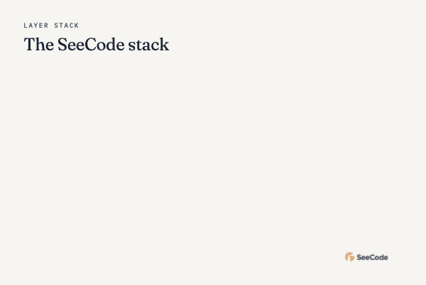</a><br><b>分层堆栈图</b><br><sub>一层叠一层</sub></td>
  <td align="center" width="33%"><a href="docs/screenshots/venn.png">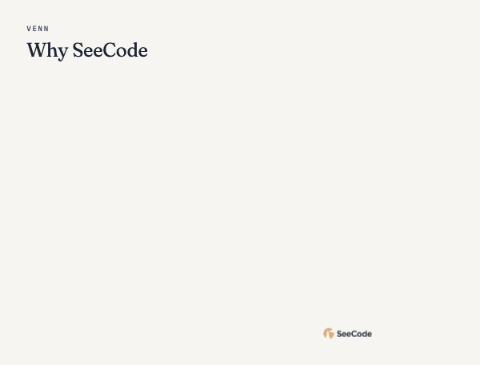</a><br><b>韦恩图</b><br><sub>交集</sub></td>
  <td align="center" width="33%"><a href="docs/screenshots/pyramid.png"></a><br><b>金字塔 / 漏斗</b><br><sub>层级排序</sub></td>
</tr>
<tr>
  <td align="center" width="33%"><a href="docs/screenshots/quadrant.png">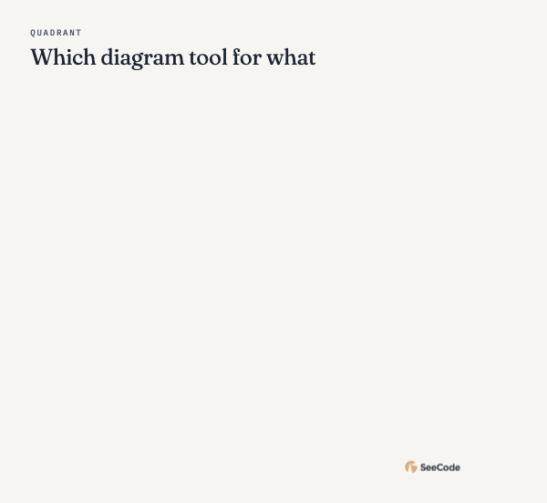</a><br><b>四象限图</b><br><sub>2×2 矩阵</sub></td>
  <td align="center" width="33%"><a href="docs/screenshots/fishbone.png">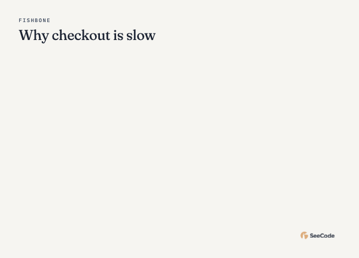</a><br><b>鱼骨图</b><br><sub>根因分析</sub></td>
  <td align="center" width="33%"><a href="docs/screenshots/wardley.png">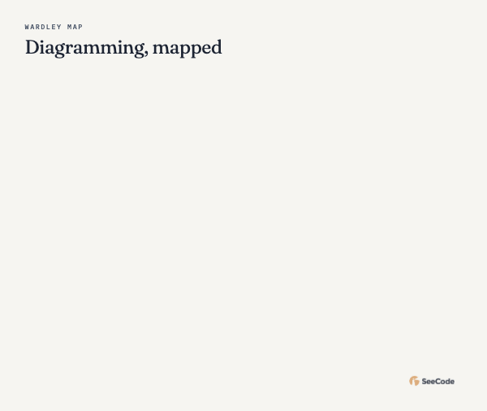</a><br><b>Wardley 地图</b><br><sub>演进阶段 × 可见度</sub></td>
</tr>
<tr>
  <td align="center" width="33%"><a href="docs/screenshots/exploded.png"></a><br><b>爆炸图</b><br><sub>一件东西的零件，等距视角</sub></td>
  <td align="center" width="33%"><a href="docs/screenshots/isometric-plan.png">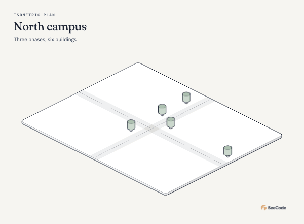</a><br><b>等距平面图</b><br><sub>俯视一层楼或一片场地</sub></td>
  <td align="center" width="33%"><a href="docs/screenshots/isometric.png"></a><br><b>等距物体</b><br><sub>描述什么就画什么</sub></td>
</tr>
<tr>
  <td align="center" width="33%"><a href="docs/screenshots/bar.png">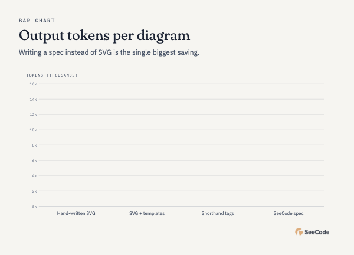</a><br><b>柱状图</b><br><sub>比较数量</sub></td>
  <td align="center" width="33%"><a href="docs/screenshots/line.png">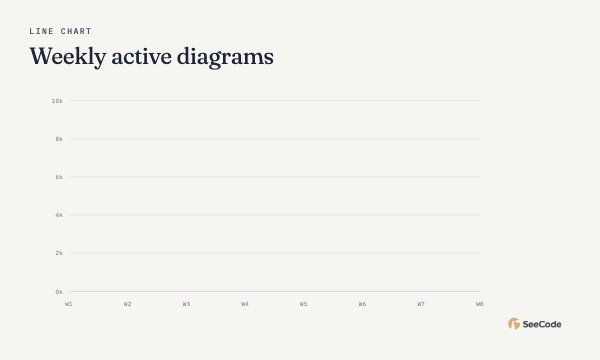</a><br><b>折线图</b><br><sub>随时间的变化</sub></td>
  <td align="center" width="33%"><a href="docs/screenshots/scatter.png">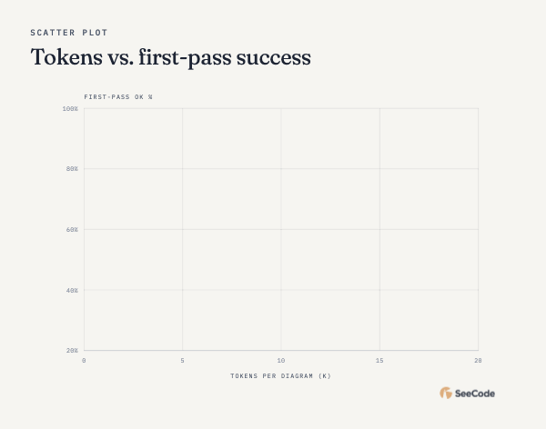</a><br><b>散点图</b><br><sub>两个指标的关系</sub></td>
</tr>
<tr>
  <td align="center" width="33%"><a href="docs/screenshots/waterfall.png">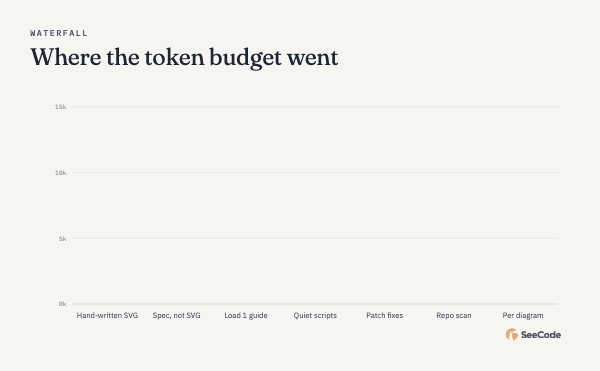</a><br><b>瀑布图</b><br><sub>累计合计</sub></td>
  <td align="center" width="33%"><a href="docs/screenshots/treemap.png">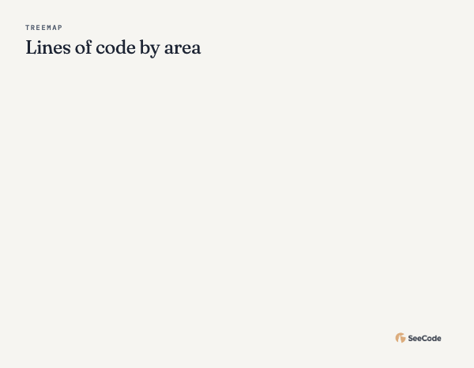</a><br><b>矩形树图</b><br><sub>部分与整体</sub></td>
  <td align="center" width="33%"><a href="docs/screenshots/heatmap.png">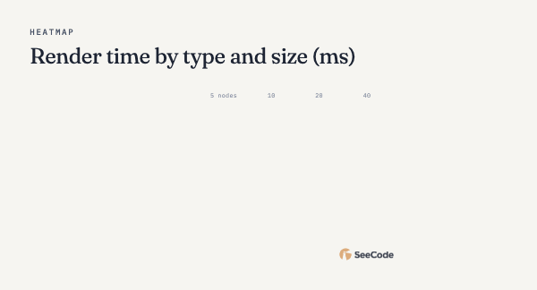</a><br><b>热力图</b><br><sub>强度网格</sub></td>
</tr>
<tr>
  <td align="center" width="33%"><a href="docs/screenshots/radar.png">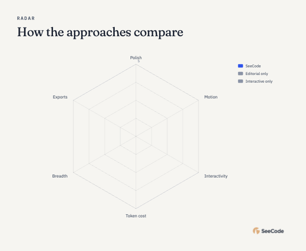</a><br><b>雷达图</b><br><sub>同一组坐标轴上的画像</sub></td>
  <td align="center" width="33%"><a href="docs/screenshots/polar.png">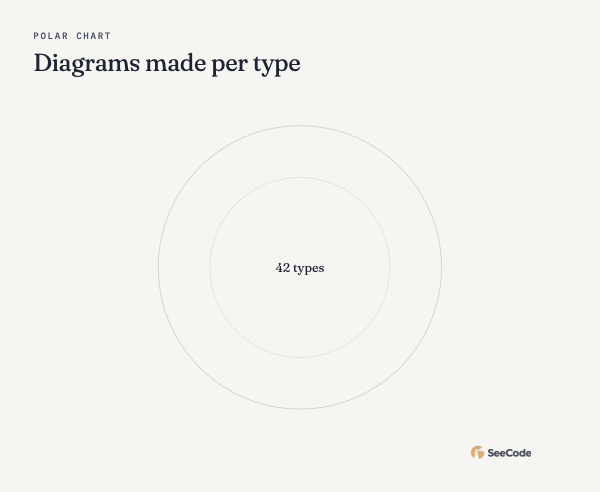</a><br><b>极坐标图</b><br><sub>周期性的数值</sub></td>
  <td align="center" width="33%"><a href="docs/screenshots/sankey.png"></a><br><b>桑基图</b><br><sub>流量的去向</sub></td>
</tr>
</table>

<sub>另有 15 种变体：哑铃图、马赛克图（marimekko）、斜率图、排名变化图（bump）、河流图（streamgraph）、山脊图（ridgeline）、气泡图、蜂群图（beeswarm）、漏斗图、咨询式四象限、终端风格循环图、OAuth 时序、生命周期状态图、模块分解图和竖版高层概览。每个示例的规格都在 <a href="examples/specs/">examples/specs</a>。</sub>

### 等距视角：什么都能拼出来

有三种图用等距 3D 来画：**等距物体**（随便什么东西，用一句话描述就行：说「一把办公椅」，agent 列出零件，SeeCode 把它画出来）、**爆炸图**（一件东西的零件被拆开、抬起并标注，加载时再组装回去）和**等距平面图**（一层楼或一片场地，按阶段一层层搭起来）。这里没有固定的图库：每个零件都是你在 3D 空间里摆放的一个实体或一根梁，再在它的顶面和侧面加上细节（屏幕、芯片、按键、卡片、窗户、隔板），可以做成空心、圆形、带棱纹、侧放，或者加一个穹顶、一个屋顶。所以同样几行规格，能画椅子、货车、手机、汉堡，也能画一条街。[原理说明（英文）](skills/seecode/references/isometric.md)

```text
用 SeeCode 画一把等距视角的办公椅，并标出各个零件。
```

<table>
<tr>
  <td align="center" width="25%"><a href="docs/screenshots/isometric.png"></a><br><b>办公椅</b><br><sub>五星脚、气压杆、坐垫</sub></td>
  <td align="center" width="25%"><a href="docs/screenshots/laptop.png">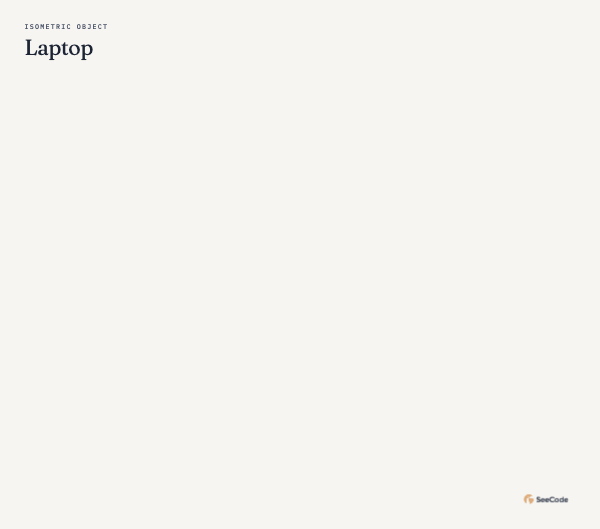</a><br><b>笔记本电脑</b><br><sub>键盘、触控板、屏幕</sub></td>
  <td align="center" width="25%"><a href="docs/screenshots/espresso-machine.png">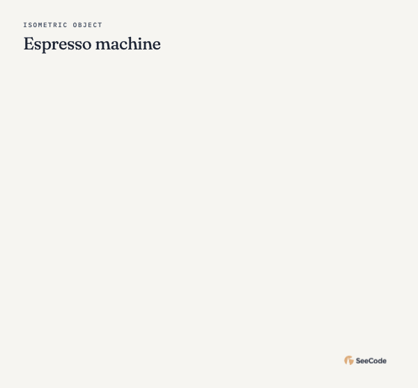</a><br><b>意式咖啡机</b><br><sub>冲煮头、蒸汽棒、杯子</sub></td>
  <td align="center" width="25%"><a href="docs/screenshots/delivery-van.png">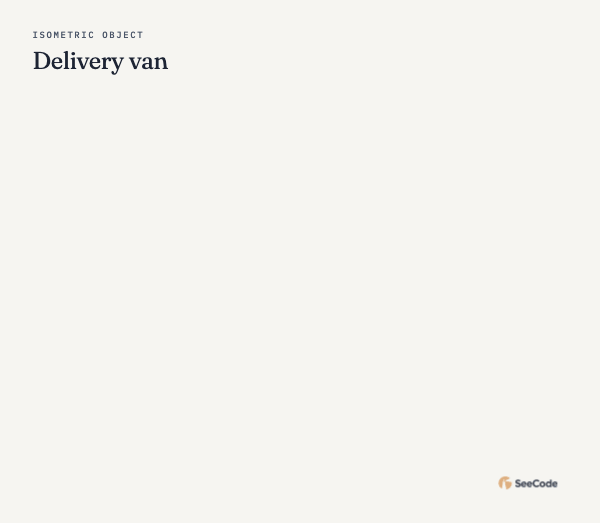</a><br><b>厢式货车</b><br><sub>侧放的车轮</sub></td>
</tr>
</table>

<table>
<tr>
  <td align="center" width="33%"><a href="docs/screenshots/exploded.png"></a><br><b>手机拆解</b><br><sub>托盘状外壳、摄像头模组、屏幕</sub></td>
  <td align="center" width="33%"><a href="docs/screenshots/keyboard.png">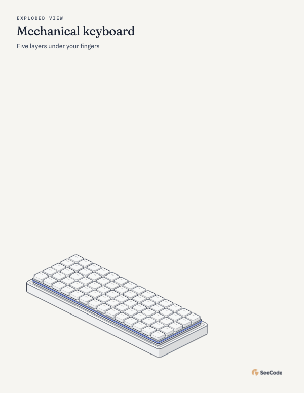</a><br><b>机械键盘</b><br><sub>外壳、PCB、定位板、轴体、键帽</sub></td>
  <td align="center" width="33%"><a href="docs/screenshots/agent-stack.png">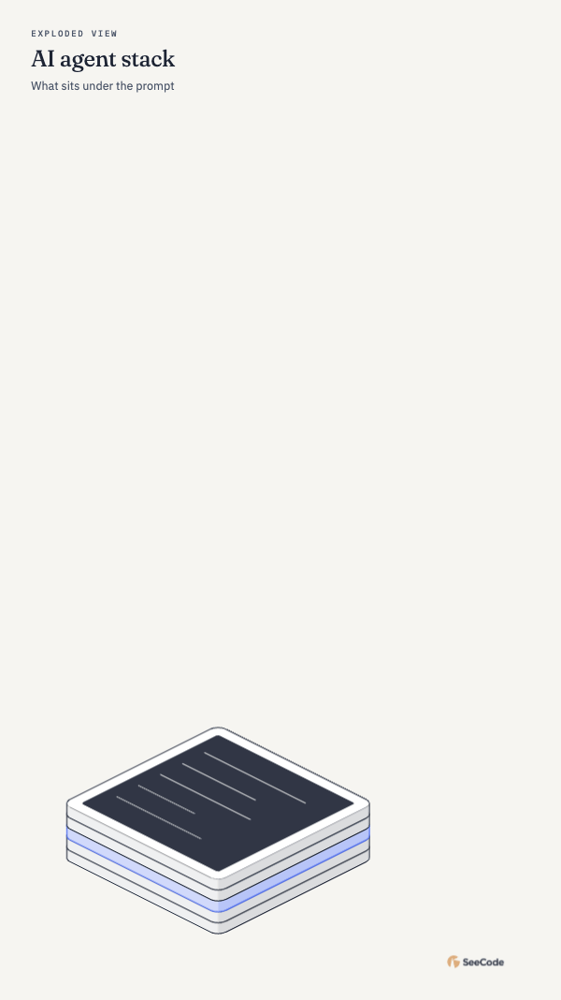</a><br><b>AI agent 技术栈</b><br><sub>密钥库、工具、技能、运行框架、界面</sub></td>
</tr>
<tr>
  <td align="center" width="33%"><a href="docs/screenshots/burger.png">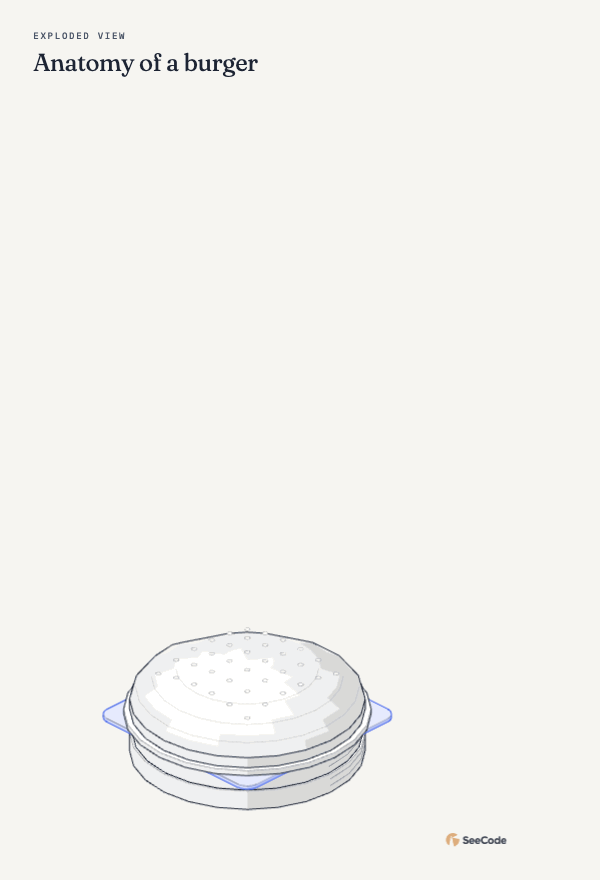</a><br><b>一个汉堡的结构</b><br><sub>撒了芝麻的圆顶面包、带纹理的夹层</sub></td>
  <td align="center" width="33%"><a href="docs/screenshots/server-rack.png">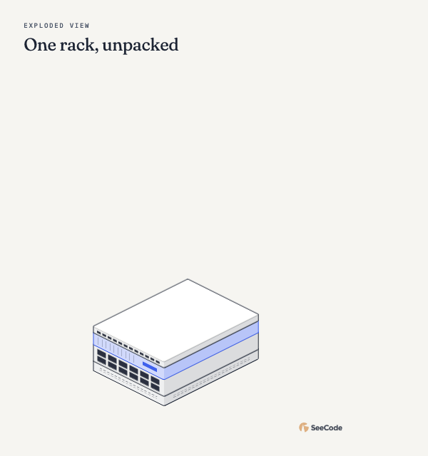</a><br><b>拆开一台机柜</b><br><sub>侧壁上的端口、硬盘位和通风口</sub></td>
  <td align="center" width="33%"><a href="docs/screenshots/office-floors.png">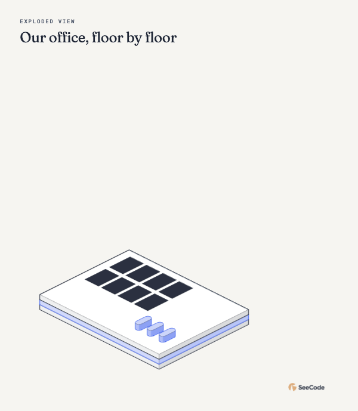</a><br><b>一层一层看办公楼</b><br><sub>工位、显示器、太阳能板</sub></td>
</tr>
<tr>
  <td align="center" width="33%"><a href="docs/screenshots/isometric-plan.png"></a><br><b>北区园区</b><br><sub>楼、路和树，按阶段建成</sub></td>
  <td align="center" width="33%"><a href="docs/screenshots/coffee-shop.png">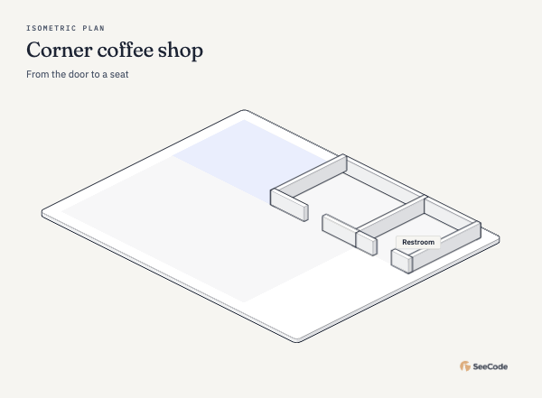</a><br><b>街角咖啡店</b><br><sub>吧台、后厨、桌子、排队栏杆</sub></td>
  <td align="center" width="33%"><a href="docs/screenshots/street.png">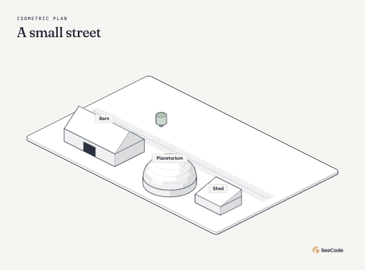</a><br><b>一条小街</b><br><sub>人字顶、四坡顶、单坡顶和一个穹顶</sub></td>
</tr>
</table>

<sub>图库里还有一个带货架的仓储配送中心。规格都在 <a href="examples/specs/isometric/">examples/specs/isometric</a>。</sub>

### 不只是代码

同样的图也能画日常的事：一年的假期安排、工资都花到哪去了、跟房东的来回沟通、一份求职申请走到了哪一步。标签可以用任何语言，中文、日文、韩文会在字与字之间自动换行；图例也可以用你自己的说法。

<table>
<tr>
  <td align="center" width="50%"><a href="docs/screenshots/leave-plan.png">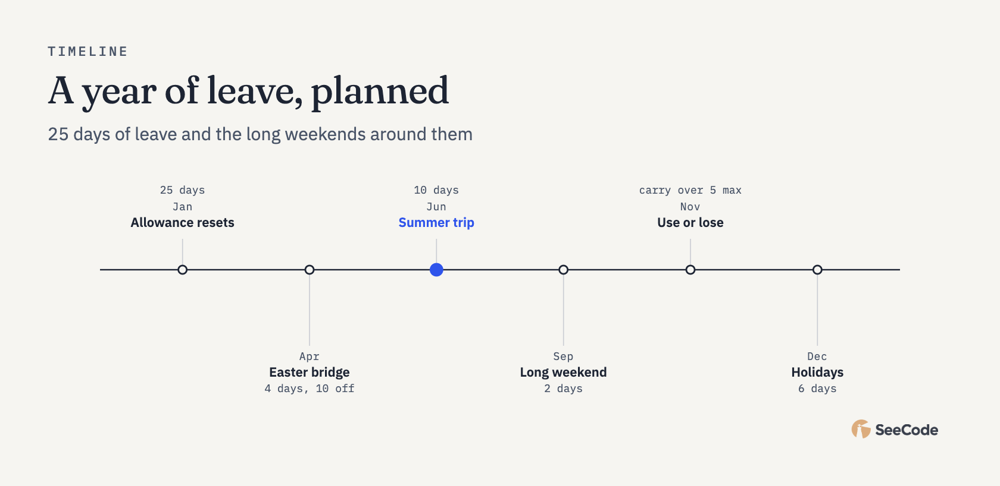</a><br><b>一年的假期</b><br><sub>时间线</sub></td>
  <td align="center" width="50%"><a href="docs/screenshots/monthly-money.png">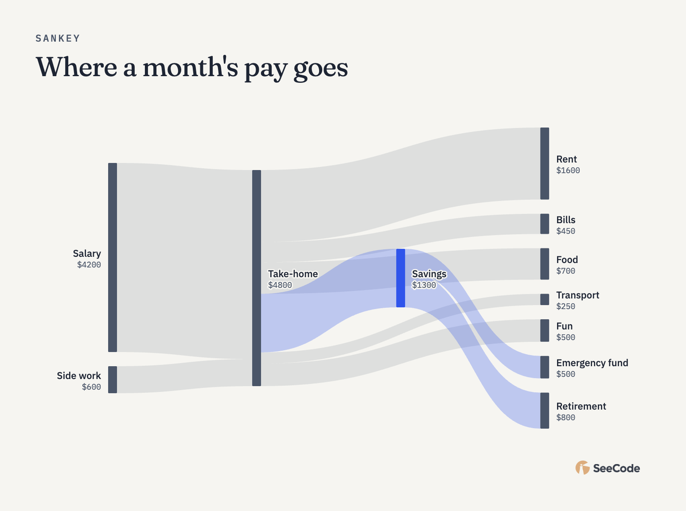</a><br><b>工资都去哪了</b><br><sub>桑基图</sub></td>
</tr>
<tr>
  <td align="center" width="50%"><a href="docs/screenshots/renting.png">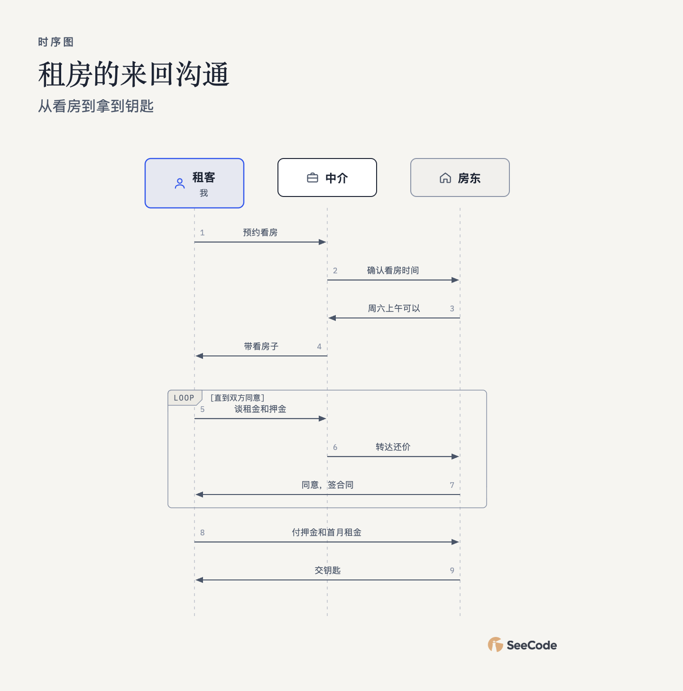</a><br><b>租房的来回沟通</b><br><sub>时序图，中文标签</sub></td>
  <td align="center" width="50%"><a href="docs/screenshots/job-search.png">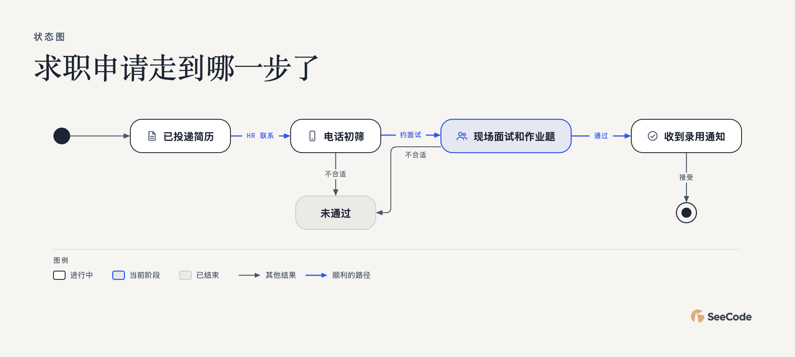</a><br><b>求职申请走到哪一步了</b><br><sub>状态图，中文标签，自定义图例</sub></td>
</tr>
</table>

## 实际效果

每张 HTML 图都是一个独立的文件，可以直接探索。发给谁都行，交互功能跟着文件走。下面的片段都录自真实的图：

<table>
<tr>
  <td width="50%" valign="top">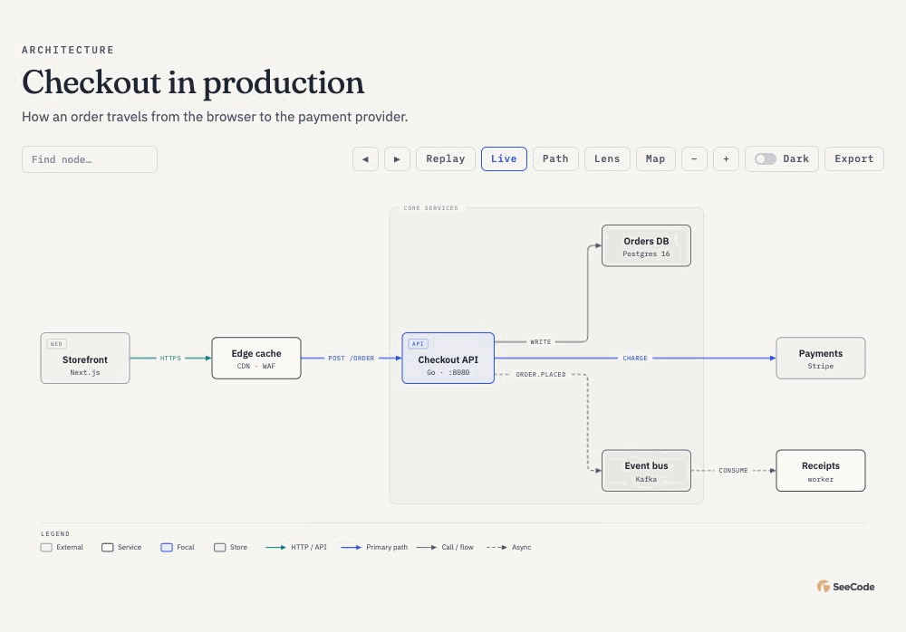<br><b>悬停追踪</b><br><sub>鼠标指向一个节点，它的连线就会亮起并流动：出去的用强调色，进来的用青绿色，其他部分自动退后。</sub></td>
  <td width="50%" valign="top">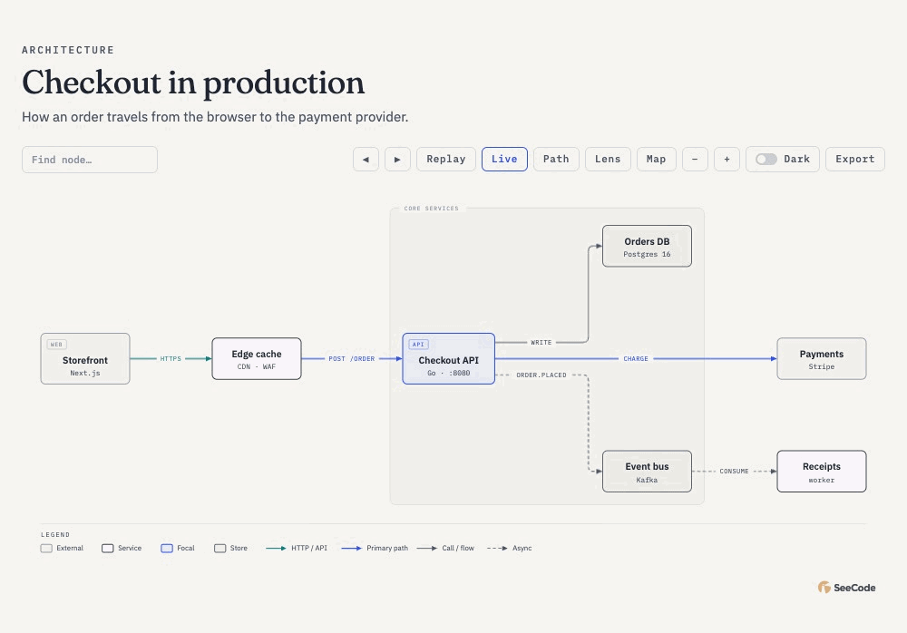<br><b>点击聚焦</b><br><sub>镜头放大，打开一个面板，列出这个节点的作用、影响范围和每一条连接。悬停在某条连接上会有一个小圆点沿着它走一遍，也可以一键显示它下游的所有东西。</sub></td>
</tr>
<tr>
  <td width="50%" valign="top">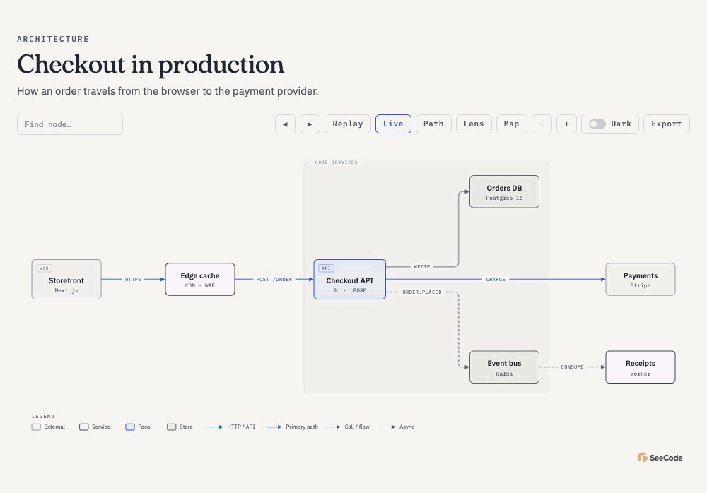<br><b>走一遍路径</b><br><sub>选好起点和终点，按播放，镜头会跟着请求一跳一跳地走，每一步都列在面板里。</sub></td>
  <td width="50%" valign="top">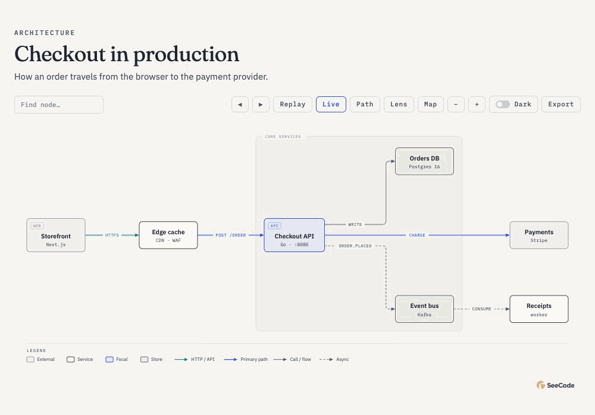<br><b>用透镜看</b><br><sub>只高亮某一类节点或连接（异步事件、主路径、存储），一次只读系统的一层。</sub></td>
</tr>
<tr>
  <td width="50%" valign="top"><br><b>逐步演示</b><br><sub>用 <kbd>←</kbd> <kbd>→</kbd> 一步一步地展示整张图是怎么搭起来的，做汇报时特别好用。</sub></td>
  <td width="50%" valign="top"><br><b>换主题，直接导出</b><br><sub>一键切到深色模式。页面里的「导出」菜单能直接保存 PNG、JPEG、SVG、GIF 和 MP4，什么都不用装（导出 GIF/MP4 时需要联网加载编码器，见<a href="#中文与国内网络">下文</a>）。</sub></td>
</tr>
<tr>
  <td width="50%" valign="top"><br><b>给它更大的地方</b><br><sub>拖动图下方的把手把画布拉高，或者按 <b>全屏</b>（<kbd>F</kbd>）在整个屏幕上缩放、平移。按 <kbd>Esc</kbd> 回来。</sub></td>
  <td width="50%" valign="top"></td>
</tr>
</table>

还有：深色模式开关、搜索、平移缩放、可以点击的缩略导航图，以及能重新打开某个视图的链接（`#focus=api`、`#route=web,db`）。<kbd>Esc</kbd> 会清掉聚焦、路径和透镜；系统的「减少动态效果」设置也会被遵守。

## 主题和你的品牌

内置浅色和深色两套主题，每张图都有深色模式开关，默认跟随系统设置。深色模式用的是柔和的 `#1a1a1a`，不是纯黑。把你的网站或设计变量（design tokens）告诉 SeeCode，它还能学会你的品牌配色。

<table>
<tr>
  <td width="33%" valign="top"><br><b>浅色</b><br><sub>暖色纸面、墨色文字，只用一种蓝色强调最重要的东西。</sub></td>
  <td width="33%" valign="top"><br><b>深色</b><br><sub>中性的 <code>#1a1a1a</code> 背景，调过对比度，每个标签都清楚可读。</sub></td>
  <td width="33%" valign="top"><br><b>你的品牌</b><br><sub>从网站、CSS 变量或一组颜色里学来。这里用的是：<br>  </sub></td>
</tr>
</table>

告诉 agent 你的品牌在哪里，三种说法都行：

```text
用 SeeCode，按我们的品牌风格来：https://your-site.com
```

<sub>把 `https://your-site.com` 换成你自己的网站。</sub>

```text
用 SeeCode，配色用这个仓库 CSS 里的品牌色。
```

```text
用 SeeCode，用这几个颜色：#D4A574, #E7E5E2, #1E1C1A。
```

SeeCode 会读取页面和它的样式表（或者你仓库里的 CSS、Tailwind 和主题文件），判断哪个颜色是背景、哪个是文字、哪个是强调色和链接色，以及正文、标题和代码分别用什么字体。然后它生成浅色和深色两个版本，并修正那些会看不清的品牌色：比如米白底上的棕褐色在浅色模式下会加深一点，深色模式则保持原样。保存成配置之前，它会先把配色给你看。没有品牌？就用内置主题。[品牌配置的工作原理（英文）](skills/seecode/references/onboarding.md)

## 导入已有的图

把一张已有的图或一个数据文件交给 SeeCode，它会**重新绘制**：内容不变，换成 SeeCode 的布局和风格，细节多少按你说的来。

```text
把 docs/architecture.mmd 转成 SeeCode 图，放到我的 PPT 里，给管理层看，简化一点。
```

| 来源 | 文件 |
|---|---|
| Mermaid（所有图类型） | `.mmd`、`.mermaid`、`.md` 里的代码块 |
| Graphviz · PlantUML · D2 | `.dot` `.gv` · `.puml` `.plantuml` · `.d2` |
| draw.io · Excalidraw | `.drawio`（也支持 `.drawio.png`/`.svg`）· `.excalidraw` |
| Structurizr · BPMN | `.dsl` · `.bpmn` |
| SQL · Prisma · DBML | `.sql` · `.prisma` · `.dbml` |
| OpenAPI · 数据 | `.yaml`/`.json` · `.csv` `.tsv` `.json` |

**一个文件里有很多张图？** 比如一份设计文档里有好几个 Mermaid 代码块、一个 draw.io 文件有好几页、一块白板有好几个画框，结果会是一个文件夹：每张图一个文件，按顺序编号，以对应的标题或页名命名，另外还有一个 `index.html` 方便浏览：

```text
用 SeeCode 重画 docs/design.md 里的每一张图，并导出给 Confluence 用。
```

```text
diagrams/design/
  01-request-flow.html   01-request-flow.svg   01-request-flow.png
  02-payment-sequence.html   …
  index.html
```

你还会收到一份简短的说明，告诉你哪些内容被合并了、哪些被去掉了。原图的颜色、字体和坐标都不会带过来。也可以直接指向代码：说「把这个仓库画出来」，它会先扫描仓库，每个节点都可以链接回它来自的文件。

## 按用途导出

SeeCode 会判断这张图要放在哪里，然后选对应的输出：

| 放在哪里 | 你得到 |
|---|---|
| 讲清楚某个东西怎么运作、artifact、分享链接 | **可交互的 HTML**（动画、追踪、聚焦、路径演示） |
| PDF、Word、打印 | 内嵌字体的 **SVG**，外加一张高清 PNG |
| README、文档站、Notion、Confluence | SVG，想要动效的话再加一张 GIF |
| PowerPoint、Keynote、Google Slides | SVG 或 PNG |
| 微信群、Slack、X、LinkedIn、演讲 | PNG、**GIF** 或 **MP4** |

每张图右下角都有一个小小的 SeeCode 标志，用的是图本身的文字颜色，放在什么背景上都看得清。想去掉，说一声就行。

不用装任何东西。图里自带的**导出**菜单能直接在浏览器里生成 PNG、JPEG、SVG、GIF 和 MP4。在命令行里导出时，SVG 只需要 Node，其他格式会用你电脑上已经装好的 Chrome 或 Edge。

尺寸会根据内容自动调整：每种格式都会选一个分辨率，既让最小的标签也清晰可读，又让文件大小合理。小图表按 3 倍导出，复杂的系统图按能让标签保持清晰的倍数导出，GIF 保持小巧，MP4 不超过 4K。[导出细节（英文）](skills/seecode/references/export.md)

<table>
<tr>
  <td width="50%"></td>
  <td width="50%"></td>
</tr>
</table>

## 中文与国内网络

- **中文标签开箱即用。** 中文、日文、韩文标签会在字与字之间自动换行。规格里设置 `lang`（比如 `"zh-CN"`）会把页面语言标成中文，方便读屏软件和字形处理。中文文字用的是你系统里的中文字体。
- **Google Fonts 加载不了？** 默认情况下，生成的图会从 Google Fonts 加载英文字体（Fraunces 和 IBM Plex），在国内可能很慢或者加载失败。把字体设置改成系统字体就不会再发这个请求：对 agent 说「把 SeeCode 的字体设置改成 system」（它会运行 `config set fonts system`），Claude Code 插件用户也可以直接运行 `/seecode:settings fonts system`。中文文字本来就用系统字体，所以不受影响。
- **页面里导出 GIF/MP4 失败？** 页面内的导出菜单生成 GIF 或 MP4 时，会从 jsDelivr 加载开源编码器。如果 jsDelivr 访问不了，就改用命令行导出：它用的是仓库里自带的编码器和你本机的 Chrome 或 Edge，不需要从 jsDelivr 下载任何东西。对 agent 说「把这张图导出成 MP4」就行。
- **离线也能导出。** 命令行导出时如果 15 秒内加载不到网页字体，会改用系统字体完成导出，并给出 `W_FONTS` 提示，不会卡住。

[PRIVACY.md](PRIVACY.md)（英文）列出了所有网络请求。

## 为什么每次都好看

- **模型从不画 SVG。** 你的 agent 只写 30 到 150 行 JSON：有什么、怎么连、大概放在哪。布局、连线走向、标签位置、排版、无障碍和动画都交给 SeeCode 的渲染器。
- **默认就是出版级的排版。** 只用一种强调色标出最重要的东西，细线边框，没有阴影，还有一个复杂度预算，图太乱时会提醒你拆分。
- **出了问题会附上修法。** 每个问题都会以一行文字返回，并附上修改提示；修复是小范围补丁，而不是整个重写。
- **省 token。** 每张图大约 1.4k 个 agent token，模型自己写 SVG 大约要 15k。
- **风格由你定。** 浅色、深色和终端风格皮肤，手绘草图风格，还有从你的网站或设计变量学来的品牌色和字体。

## 什么时候不该用

- 一份清单：用表格或列表。
- 前后属性对比：用表格。
- 只有一个带标签的框：写一句话就够了。

如果读者从图里学不到比一段好文字更多的东西，就别画图。

## 安装

**Claude Code**（插件，推荐：每次发布都会自动更新）：

```text
/plugin marketplace add Aryanutkarsh/seecode
/plugin install seecode@seecode
```

运行一次 `/plugin` → **Marketplaces** → **seecode** → **Enable auto-update**。插件还会添加 `/seecode:export`、`/seecode:import`、`/seecode:doctor` 和 `/seecode:settings` 这几个命令。

<details>
<summary><b>其他 Agent Skills 工具、Codex、Copilot、Claude.ai、手动安装</b></summary>

**任何支持 Agent Skills 的工具**（Claude Code、Cursor、Codex、OpenCode……），通过 [skills.sh](https://skills.sh)：

```bash
npx skills add Aryanutkarsh/seecode -g
```

**Codex：**

```bash
codex plugin marketplace add Aryanutkarsh/seecode
codex plugin add seecode@seecode
```

**GitHub Copilot：**

```bash
copilot plugin marketplace add Aryanutkarsh/seecode
copilot plugin install seecode@seecode
```

**Claude.ai / Claude Desktop：** 从[最新版本](https://github.com/Aryanutkarsh/seecode/releases/latest)下载 `seecode.zip`，在 **Settings → Capabilities → Skills** 里上传。所有功能都能用；因为沙盒里没有浏览器，图片和视频需要用图里自带的导出菜单生成。

**手动安装：**

```bash
git clone https://github.com/Aryanutkarsh/seecode ~/code/seecode
ln -s ~/code/seecode/skills/seecode ~/.claude/skills/seecode
```

需要 Node 20 或更高版本。可以用 `/seecode:doctor` 或 `node skills/seecode/scripts/seecode.mjs doctor` 检查环境。

</details>

### 更新

合并到 `main` 的每一次改动都会发布成新版本，附带一个 [release](https://github.com/Aryanutkarsh/seecode/releases) 和新的 `seecode.zip`。怎么更新取决于你当初怎么装的：

| 安装方式 | 怎么更新 |
|---|---|
| Claude Code 插件 | 打开自动更新后就会自动更新（`/plugin` → **Marketplaces** → **seecode** → **Enable auto-update**）。想马上更新：`/plugin` → **Marketplaces** → **seecode** → **Update** |
| `npx skills add` | `npx skills update seecode -g`（项目内安装去掉 `-g`）。用这种方式安装的技能不会自动更新 |
| Codex / Copilot 插件 | 在 agent 的插件管理里更新，或者重新运行上面的安装命令 |
| Claude.ai / Claude Desktop | 从[最新版本](https://github.com/Aryanutkarsh/seecode/releases/latest)下载 `seecode.zip`，在 **Settings → Capabilities → Skills** 里重新上传 |
| 手动克隆 | 在克隆的目录里运行 `git pull`（软链接会自动用上新版本） |

然后开一个新的 agent 会话：技能是在会话开始时加载的。想知道自己装的是哪个版本，看已安装的 `SKILL.md` 顶部的 `version:` 一行，或者运行 `/seecode:doctor`。

## 了解更多

以下文档目前只有英文版：

- [CLI 参考和整个流程是怎么运作的](docs/cli.md)
- [技能说明](skills/seecode/SKILL.md) · [各图表类型指南](skills/seecode/references/types/) · [设置](skills/seecode/references/settings.md)
- [示例规格](examples/specs/)

## 参与贡献

欢迎提 issue、pull request 和新的图表类型。先看看[贡献指南](CONTRIBUTING.md)，也请遵守[行为准则](CODE_OF_CONDUCT.md)。安全问题请按 [SECURITY.md](SECURITY.md) 里的说明私下报告。

## 隐私

SeeCode 没有服务器、没有账号，也没有任何遥测。生成的图会从 Google Fonts 加载字体（可以用 `config set fonts system` 关掉），页面内的 GIF/MP4 导出会从 jsDelivr 加载编码器。[PRIVACY.md](PRIVACY.md) 列出了每一个请求。

## 致谢

SeeCode 从几个优秀的开源项目里学到了很多：从 Cathryn Lavery 的 [diagram-design](https://github.com/cathrynlavery/diagram-design) 借鉴了它对各类图表的编辑式设计思路和等距投影，从 tt-a1i 的 [archify](https://github.com/tt-a1i/archify) 借鉴了它可探索、带动画的查看器。等距物体这个类型还受到了 April Zhu（[@Aprilzz423](https://x.com/Aprilzz423)）的 [iso-glow](https://isoglow.dev) 和 Tolga Cohce 的 [iso-figure](https://github.com/MrBongoC/ai-iso-skill) 的启发，它们展示了用简单零件拼出的等距图形能走多远。这些项目都使用 MIT 许可证；SeeCode 的代码是自己写的。谢谢你们。

如果 SeeCode 对你有用，点个 ⭐ 能帮更多人发现它。

## 许可证

[MIT](LICENSE)。打包在内的编码器和字体列在 [THIRD_PARTY_LICENSES.md](THIRD_PARTY_LICENSES.md) 里。

<p align="center"></p>
